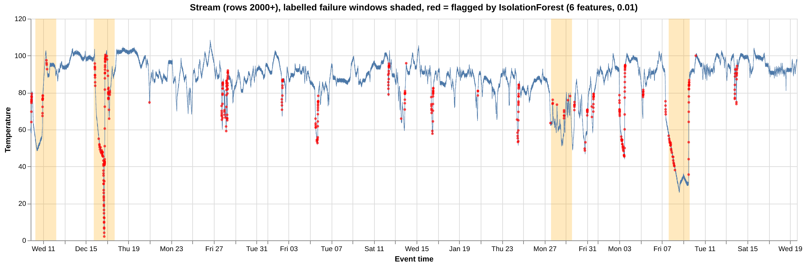
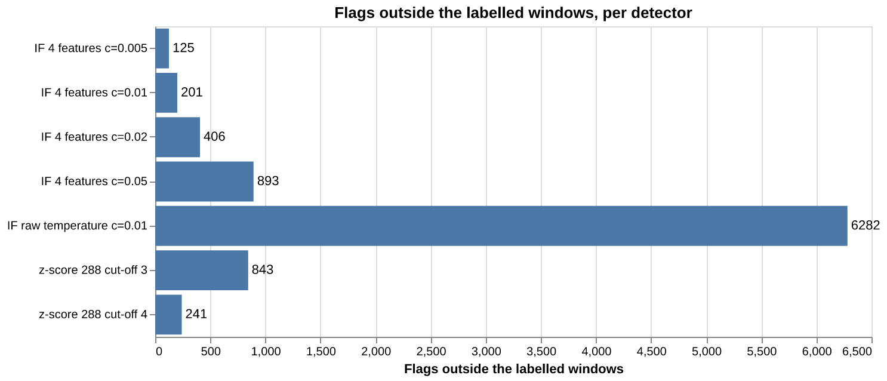

# Real-Time Monitoring of an Industrial Machine: Streaming Anomaly Detection with Kafka, IsolationForest and Streamlit

> TODO (student): name, roll number, course "Data Stream Analytics", instructor, submission date.

Every number in this draft comes from a command that was run on the finished system: `report/results.md` (written by
`python scripts/collect_results.py` after a full replay), `report/evaluation.csv` (written by
`python scripts/evaluate.py`) and the timed rehearsal recorded in `DEMO.md`. Every code snippet is copied unchanged
from the file it names.

## Abstract
This project builds a six-layer streaming pipeline that monitors the temperature of one industrial machine in real
time: a paced replay of the NAB machine-temperature dataset is published to Apache Kafka, a Python stream processor
keeps a 1-hour and a 24-hour sliding window and scores every reading with an IsolationForest, MySQL serves the
results, and a Streamlit dashboard re-queries the database every 2 seconds. On a full replay of 20,695 events the
pipeline stored 20,683 readings, dropped the 12 repeated timestamps, kept consumer lag at 0, and flagged 2.06% of the
stream, with at least one flag in all 4 of the dataset's labelled failure windows. Training on six behavioural
features instead of the raw temperature reduced the share of the stream flagged from 36.46% to 2.06% on the same
training data, and the two 24-hour features catch the slow decline before the catastrophic failure as it starts
instead of about 45 hours later.

## 1. Architecture
```text
                      offline, once: python -m src.train_model  (rows 0-1999 -> models/anomaly_model.joblib)
                                                   |
                                                   v
 [1] CSV replay      [2] Kafka 4.3.1 (KRaft)    [3]+[4] processor              [5] MySQL 8.4        [6] Streamlit
 src/producer.py --> topic machine-temperature --> group "scoring":       --> readings          --> dashboard/app.py
 paced JSON events   1 partition, key machine-1    window, IsolationForest,    metrics_current       fragment re-queries
                          |                         hourly tumbling window     hourly_stats          every 2 s
                          |                                                    forecasts  <------+
                          +--------------------> group "forecast": src/forecaster.py (ARIMA) ----+
```
Data moves left to right and each layer talks only to its neighbours: the producer knows nothing about MySQL and the
dashboard knows nothing about Kafka. Two consumer groups read the same topic independently, each with its own offsets.

> TODO (student): optionally redraw this diagram as a figure.

## 2. Dataset
- Source: `machine_temperature_system_failure.csv` from the Numenta Anomaly Benchmark (NAB) [1, 2]: 22,695 readings of
  one industrial machine, one every 5 minutes, from 2 Dec 2013 to 19 Feb 2014. The unit is not stated, so the value is
  called "temperature" without a unit.
- Labels: NAB's file `combined_windows.json` marks 4 failure windows of about two days each (a planned shutdown, a
  hard-to-detect change, and the catastrophic failure it led to).
- Split by time, once: rows 0-1999 (2-9 Dec 2013, before the first labelled window) train the model offline; rows 2000
  onward (20,695 readings) are the live stream. The model never scores a reading it was trained on.
- Quirk: 12 readings on 7 Jan 2014 repeat earlier timestamps (the clock steps back). The producer sends them unchanged
  and the processor drops them as late events.
- One event on the topic (real, from the console consumer in the demo rehearsal):
```json
{"sensor_id": "machine-1", "seq": 2049, "event_time": "2013-12-10 00:00:00", "temperature": 80.14151889, "produced_at": "2026-10-11T07:45:42.608Z"}
```
`event_time` is when the sensor took the reading; `produced_at` is when the producer sent it, which lets the processor
measure pipeline lag.

## 3. The six layers

### 3.1 Layer 1, data source: the producer
**Why it exists.** A CSV file is not a stream. The producer turns it into one by sending one event at a time at a set
rate, so the rest of the pipeline sees data arrive the way a sensor would deliver it. A replay is repeatable, which is
what a demo and an evaluation need. Rows with a blank or non-numeric value are skipped instead of crashing the producer.

Source: `src/producer.py` (main loop)
```python
            # Pacing: event number `sent` is due at started + sent / rate.
            # Sleeping until that moment keeps the real rate on target without drift.
            delay = started + sent / args.rate - time.monotonic()
            if delay > 0:
                time.sleep(delay)

            producer.send(config.KAFKA_TOPIC, key=config.SENSOR_ID, value=make_event(seq, event_time, temperature))
```
The message key `machine-1` sends every reading of this machine to the same partition, so they stay in order.
`--start-at`, `--limit` and `--resume` (from a saved position) make the replay controllable during a demo.

### 3.2 Layer 2, streaming tool: Apache Kafka
**Why it exists.** Kafka is a durable buffer between the producer and its consumers. It decouples them in time and
speed: the producer never waits for the processor, a stopped consumer catches up from its committed offset, and two
independent consumer groups (`scoring` and `forecast`) read the same events.

**No ZooKeeper.** The course guide starts ZooKeeper before Kafka. Kafka 4 removed ZooKeeper: it runs in KRaft mode,
where the broker manages its own metadata, so a single container is the whole cluster.

Source: `docker-compose.yml` (broker service)
```yaml
      KAFKA_PROCESS_ROLES: broker,controller
      # Listen on all interfaces inside the container...
      KAFKA_LISTENERS: PLAINTEXT://:9092,CONTROLLER://:9093
      # ...but tell clients to connect to localhost:9092, which the host can reach.
      KAFKA_ADVERTISED_LISTENERS: PLAINTEXT://localhost:9092
```
The topic `machine-temperature` has one partition, which keeps the readings in order for the rolling window.

### 3.3 Layer 3, stream processor
**Why it exists.** This is where the stream's state lives: the processor remembers the last hour of readings, the
running peak and minimum, and its counters between events. Without it every reading would be judged on its own.

The sliding windows are a `deque(maxlen=12)` and a `deque(maxlen=288)`: twelve readings at 5-minute spacing are one
hour of event time, 288 are one day, and the oldest reading drops out by itself when a new one arrives on a full
window. The same class computes the model's features in training and in serving.

Source: `src/features.py` (`RollingFeatures.update`)
```python
    def update(self, temperature):
        """Add one reading and return its features (plus the rolling average)."""
        self.window.append(temperature)
        self.long_window.append(temperature)

        rolling_avg = sum(self.window) / len(self.window)
        # Sample standard deviation needs at least 2 values.
        rolling_std = statistics.stdev(self.window) if len(self.window) >= 2 else 0.0
        delta = temperature - self.previous if self.previous is not None else 0.0
        self.previous = temperature
        # Until 288 readings have arrived the 24-hour window is simply shorter,
        # so these work from the first reading and the warm-up stays 12 readings.
        daily_avg = sum(self.long_window) / len(self.long_window)
        daily_std = statistics.stdev(self.long_window) if len(self.long_window) >= 2 else 0.0
```
Late and repeated events are dropped and counted, which is a simple form of event-time handling:

Source: `src/processor.py` (`process_batch`)
```python
        # Late or repeated event: not newer than the last accepted one. Drop and count it.
        if state["last_event_time"] is not None and event_time <= state["last_event_time"]:
            late += 1
            continue
```
**Restart safety.** Kafka offsets are committed only after the MySQL write succeeds, and `readings.kafka_offset` is
unique with `INSERT IGNORE`, so a crash can replay a batch but never store it twice (at-least-once delivery with
idempotent writes). On restart the processor refills both windows from the last 288 stored rows and its counters
from `metrics_current`; a test checks that a restarted run scores exactly the rows an uninterrupted run scores, and a
full replay with a Ctrl+C stop and a `kill -9` in the middle stored the same 426 flags as an uninterrupted one.

Source: `src/processor.py` (`main`)
```python
            # MySQL first, Kafka second: the offsets only move on once the data is safe.
            try:
                db.write_batch(conn, [tuple(r) for r in rows], metrics, hourly_rows(rows))
```

### 3.4 Layer 4, machine learning: IsolationForest
**Why it exists.** It turns raw numbers into a decision: is this reading normal? IsolationForest [3] is unsupervised,
so it needs no labelled failures to train. It isolates points with random splits; unusual points are isolated in fewer
splits, which gives them a lower score.

**Train offline, serve live.** `src/train_model.py` fits the model once on the training rows and saves it with the
feature names and the scikit-learn version; the processor loads it once at startup and never retrains.

Source: `src/train_model.py` (`main`)
```python
    model = IsolationForest(n_estimators=N_ESTIMATORS, contamination=CONTAMINATION, random_state=RANDOM_STATE)
    started = time.perf_counter()
    model.fit(rows)
```
`N_ESTIMATORS = 200`, `CONTAMINATION = 0.01`, `RANDOM_STATE = 42`. The model was fitted on 1,988 rows (rows 12-1999;
the first 12 only fill the window) and flags 20 of its own training rows (1.01%), as contamination 0.01 intends.

**Scoring in batches.** The processor scores each polled batch with one `predict` and one `decision_function` call;
the first 12 readings after a cold start are never flagged because the window is still filling.

Source: `src/processor.py` (`process_batch`)
```python
        predictions = model.predict(model_rows)
        scores = model.decision_function(model_rows)
        for row, prediction, score, warm_up in zip(rows, predictions, scores, warming_up):
            row[8] = float(score)   # negative = anomalous
            row[9] = 1 if prediction == -1 and not warm_up else 0
```

### 3.5 Layer 5, database: MySQL as the serving layer
**Why it exists.** The processor writes and the dashboard reads, and neither waits for the other. `readings` holds
one row per accepted event (for the curve and the red markers); `metrics_current` holds exactly one row, overwritten
with every batch, because "current state" is one thing, not a growing list. Two extra tables hold the hourly windows
and the forecasts.

Source: `src/db.py`
```python
# INSERT IGNORE skips a row whose kafka_offset (UNIQUE) is already stored, so a
# batch replayed after a crash can never be stored twice.
INSERT_READINGS = (
    f"INSERT IGNORE INTO readings ({', '.join(READING_COLUMNS)}) "
    f"VALUES ({', '.join(['%s'] * len(READING_COLUMNS))})"
)
```
Each batch (readings, the metrics row and the hourly rows) is written in one transaction: all of it, or none of it.

### 3.6 Layer 6, visualization: the Streamlit dashboard
**Why it exists.** It is the only part a user sees, and it must stay live on its own. See section 5.

### 3.7 Extras: a second consumer group and an event-time tumbling window
**Forecaster.** `src/forecaster.py` reads the same topic in its own consumer group, `forecast`. After every 12 new
readings it fits ARIMA(1,1,1) on the last 288 readings (24 hours) and stores the next 12 readings with a 95% interval.
Fitting is slower than scoring, so it runs in its own process: stopping it only grows its own lag. In the demo
rehearsal its lag grew from 18 to 116 in 8 s while the processor's stayed at 1.

Source: `src/forecaster.py` (`handle_batch`)
```python
        # Fit once the window holds a full 24 hours, then after every 12 new readings.
        if len(state["window"]) == HISTORY and state["new_since_fit"] >= EVERY:
```
**Hourly window.** The 1-hour rolling mean is a sliding window (it moves with every reading). The processor also
groups readings into fixed, non-overlapping hours of event time (a tumbling window) and merges them into
`hourly_stats`, which feeds the "anomalies per hour" bar chart.

Source: `src/processor.py` (`hourly_rows`)
```python
        hour_start = event_time.replace(minute=0, second=0, microsecond=0)
        hours.setdefault(hour_start, []).append((temperature, is_anomaly))
```

## 4. ML model: why these six features
The course guide trains IsolationForest on the raw value. On this dataset that does not survive the train/stream split:
the training week only spans 52.7 to 94.4, while the machine later runs normally up to 108.51. A raw-temperature model
therefore treats every normal high reading as an anomaly.

The model instead scores six features per reading. Four describe the last hour: the temperature, its deviation from
the 1-hour mean, the 1-hour standard deviation, and the change since the previous reading. Two describe the last day:
`drift`, the temperature minus the 24-hour mean, and `daily_std`, the 24-hour standard deviation. These describe
behaviour (sudden change, instability, distance from the day's normal level), which stays comparable as the level
drifts. `python scripts/evaluate.py` compares the options on the 20,683 stream readings against the 4 labelled windows
(`report/evaluation.csv`):

| Detector | Stream flagged | Windows hit | Flags inside | Flags outside | First-flag delay w1 / w2 / w3 / w4 (min) |
| --- | --- | --- | --- | --- | --- |
| IsolationForest, 6 features, c = 0.005 | 1.33% | 4 of 4 | 108 | 168 | 965 / 150 / 210 / 65 |
| **IsolationForest, 6 features, c = 0.01 (used)** | **2.06%** | **4 of 4** | **161** | **265** | 965 / 145 / 210 / 0 |
| IsolationForest, 6 features, c = 0.02 | 6.05% | 4 of 4 | 553 | 699 | 0 / 135 / 205 / 0 |
| IsolationForest, 6 features, c = 0.05 | 13.50% | 4 of 4 | 1036 | 1756 | 0 / 120 / 190 / 0 |
| IsolationForest, 4 one-hour features, c = 0.01 (the first model) | 1.37% | 4 of 4 | 83 | 201 | 975 / 165 / 210 / 2695 |
| IsolationForest, raw temperature, c = 0.01 (the guide's approach) | 36.46% | 4 of 4 | 1259 | 6282 | 0 / 0 / 1365 / 25 |
| Rolling z-score over the previous 288 readings, cut-off 3 (no ML) | 4.65% | 4 of 4 | 118 | 843 | 1035 / 100 / 0 / 2700 |
| Rolling z-score over the previous 288 readings, cut-off 4 (no ML) | 1.47% | 2 of 4 | 63 | 241 | - / 100 / - / 2700 |




- **Contamination** is the share of training data treated as anomalous; it sets the threshold. Higher values catch
  failures earlier but raise more flags outside the windows; every setting tested hits all 4 windows. 0.01 was kept.
- The no-ML baseline needs 4× as many flags outside the windows (843) to hit all 4; with a stricter cut-off it misses 2.
- **Why the two 24-hour features were added.** The first model used only the four 1-hour features. They describe
  sudden change, so a slow drift was caught late: window 4, the catastrophic failure, is a slow decline, and its first
  flag came 2,695 minutes (about 45 hours) after the window opened, at the fast recovery near its end. With the
  24-hour features a first reading is flagged at 14:55 on 7 Feb, the minute the window opens, and the decline that
  starts window 2 is flagged at its first reading (15 Dec 20:15). Flags inside the windows rise from 83 to 161, flags
  outside from 201 to 265, and the share of the stream flagged from 1.37% to 2.06% (the model still flags 1.01% of its
  own training week).
- **But the window-4 catch is weak.** During the slow decline of window 4 the new score sits right at the cut-off
  (−0.026 to +0.051 in the 12 hours after 18:45 on 7 Feb), so the early flags are single readings scattered along the
  decline (scores −0.001 to −0.024), not a clear signal. The model flags in 144 separate runs over the stream against
  51 for the first model. Counting a reading only when at least 3 of the last 6 are flagged (the debounce monitoring
  tools use, and in the spirit of Numenta's advice to threshold a short moving average of the score rather than each
  raw score [5]), window 4 is first caught 2,705 minutes after it opens, as late as with the first model. What
  survives the rule: 123 flags inside the windows against 82, and window 2 caught after 155 minutes instead of 1,320.
  The dashboard therefore draws these sustained alerts as red bands and keeps single flags as small points.
- **Honest caveats.** (1) The 24-hour features were chosen after seeing that the first model missed window 4, so the
  labels influenced the design; the evaluation is not fully blind. (2) The result depends on the random trees:
  `report/seed_check.csv` refits both models with random_state 0, 1, 2, 3 and 42. The 6-feature model catches window 4
  within 65 minutes for 3 of the 5 seeds (seeds 2 and 3 are still about 45 hours late), and always has more flags
  inside the windows (102 to 161 against 80 to 83 for the first model). Contamination (0.01), n_estimators (200) and
  random_state (42) were not changed.
- A slow, moderate drift is still not flagged: on 22-23 Dec the temperature falls from 97.5 to 72.9 over 15 hours and the
  lowest score is +0.014 (close to the cut-off, shown as "watch" on the dashboard, but not below 0).
- A flag outside a labelled window is unlabelled, not proven false.

## 5. Dashboard
A dashboard can look frozen for two independent reasons: no new data is arriving, or the view does not re-query. Both
are handled. The live part of the page is one function decorated with `st.fragment(run_every=...)`, which Streamlit
reruns every 2 seconds (1-10 s, or paused, from the sidebar) without reloading the page, so the sidebar keeps its
state. This replaces the guide's `<meta http-equiv="refresh">` tag, which reloads everything.

Source: `dashboard/app.py`
```python
@st.fragment(run_every=None if paused else refresh_s)
def live_view():
    """Everything that changes. Only this function reruns on the timer."""
```
Every query goes to MySQL; nothing is served from a cache:

Source: `dashboard/app.py` (`run_query`)
```python
    with conn.engine.connect() as db:
        return pd.read_sql(text(sql), db, params=params)
```
Streamlit's own `conn.query()` caches results forever unless `ttl=0` is passed, and it leaves each pooled connection
for the garbage collector to return; at several queries every 2 seconds the connection pool ran dry during testing, so
the dashboard uses this small helper instead.

The page shows six KPI tiles (latest temperature, 1-hour average, running peak, events processed, anomalies flagged,
pipeline lag), a curve of the newest 288 readings (24 hours of event time) with the rolling average, red points on
flagged readings, the labelled failure windows shaded and the dashed ARIMA forecast ahead of the curve, a bar chart of
anomalies per hour, and the last 10 flagged readings. When the newest data is more than 10 s old, the status line
changes to "No new data for N s. The dashboard is still refreshing."

> TODO (student): add a screenshot of the live dashboard here (`report/screenshots/dashboard.png`).
> TODO (student): the dashboard was extended on 2026-10-12 (history browser, Model / Hourly / Pipeline / Readings
> log / Run report tabs, final run report). Describe the views you use and add screenshots of the Model view tab
> (`report/screenshots/dashboard_model.png`) and the final run report (`report/screenshots/final_report.png`).

## 6. Results
From one full replay at 200 events per second on a reset system (`report/results.md`):

| Measure | Value |
| --- | --- |
| Events sent | 20,695 (in 103 s) |
| Rows stored | 20,683 (no duplicate offsets) |
| Late events dropped | 12 (processed + dropped = sent) |
| Peak temperature | 108.51 at 2013-12-26 15:45 |
| Minimum temperature | 2.08 at 2013-12-16 17:25 |
| Readings flagged | 426 (2.06%): 161 inside the labelled windows, 265 outside |
| Labelled failure windows with at least one flag | 4 of 4 |
| Pipeline lag (send to store, per reading) | average 82.3 ms, median 85 ms, 95th percentile 124 ms, maximum 183 ms |
| Consumer lag when the replay ended | 0 for `scoring`, 0 for `forecast` |
| ARIMA forecasts | 1,700 fits; 1-hour-ahead mean absolute error 1.50 (median 0.95); 91.2% of actual readings inside the 95% interval |
| Hours in `hourly_stats` | 1,725 |

| Window | Labelled period | First flag | Delay (min) |
| --- | --- | --- | --- |
| 1 | 2013-12-10 06:25 to 2013-12-12 05:35 | 2013-12-10 22:30 | 965 |
| 2 | 2013-12-15 17:50 to 2013-12-17 17:00 | 2013-12-15 20:15 | 145 |
| 3 | 2014-01-27 14:20 to 2014-01-29 13:30 | 2014-01-27 17:50 | 210 |
| 4 | 2014-02-07 14:55 to 2014-02-09 14:05 | 2014-02-07 14:55 | 0 |

Live demo (from `DEMO.md`, replay from 10 Dec 2013 at 10 events per second, re-timed with the 6-feature model): the
first flag appeared 26.9 s after the producer started, the first forecast 28.7 s, the temperature started to fall at
2 min 48 s (flagged at once) and reached its minimum at 3 min 14 s; in the original rehearsal, after the producer was stopped, the "No new data" warning appeared after 12.3 s while the page kept
refreshing, and `--resume` continued with no gap.

The ARIMA interval covered 91.2% of actual readings rather than the nominal 95%: the forecast follows the short-term
trend and misses sudden changes such as the collapse on 16 Dec (largest error 51.90).

> TODO (student): add screenshots: the console consumer showing events (`report/screenshots/console_consumer.png`),
> the two consumer groups with their lag (`report/screenshots/consumer_groups.png`), and the MySQL row count climbing
> (`report/screenshots/mysql_counts.png`). The commands are in DEMO.md, section 4.

## 7. Conclusion
The pipeline meets every item of the brief: Kafka carries the stream, an IsolationForest scores every reading live,
MySQL serves the results, and the Streamlit dashboard updates on its own; the full pipeline runs end to end from the
README on a reset system. The demo makes the course guide's central point visible: stopping the producer freezes the
numbers while the page keeps refreshing, because "live" depends on data moving, not on the refresh timer.

Beyond the minimum, the project measures its detector against real failure labels (4 of 4 windows, 2.06% of the
stream flagged, the catastrophic failure's slow decline caught as it starts), shows why the guide's raw-value approach fails on this data, handles repeated timestamps as late
events, survives restarts without losing or duplicating readings, and runs a second, independent consumer group.

**Limits.** One sensor; a replayed, not live, source; the 24-hour features were chosen with the labels in view, and
their early catch of window 4 is made of single near-threshold flags (as a sustained alert it is still about 45 hours
late); a moderate slow drift (22-23 Dec) is still not flagged; flags outside the labelled windows cannot be confirmed or refuted; ARIMA cannot forecast a failure.

**Next steps.** A blind check of the 24-hour features on other NAB machine series, a longer training period (one
week holds few slow drifts), more sensors on more partitions, and periodic retraining on recent normal data.

> TODO (student): write your own "What I learned" paragraph here.

## Sources
1. A. Lavin and S. Ahmad, "Evaluating Real-Time Anomaly Detection Algorithms - The Numenta Anomaly Benchmark," in
   *14th IEEE International Conference on Machine Learning and Applications (ICMLA 2015)*, Miami, FL, USA, 2015,
   pp. 38-44, doi: 10.1109/ICMLA.2015.141 (arXiv:1510.03336).
2. Numenta Anomaly Benchmark, dataset `realKnownCause/machine_temperature_system_failure.csv` and labels
   `labels/combined_windows.json`: https://github.com/numenta/NAB
3. F. T. Liu, K. M. Ting and Z.-H. Zhou, "Isolation Forest," in *Proceedings of the 8th IEEE International Conference
   on Data Mining (ICDM 2008)*, Pisa, Italy, 2008, pp. 413-422, doi: 10.1109/ICDM.2008.17.
4. scikit-learn documentation, `sklearn.ensemble.IsolationForest` and outlier detection:
   https://scikit-learn.org/stable/modules/outlier_detection.html
5. S. Ahmad and S. Purdy, "Real-Time Anomaly Detection for Streaming Analytics," arXiv:1607.02480, 2016
   (section 3.2: threshold a short moving average of the anomaly score, not each raw score).
5. Apache Kafka documentation and quickstart (KRaft mode): https://kafka.apache.org/documentation/ and
   https://kafka.apache.org/quickstart ; Docker image `apache/kafka`: https://hub.docker.com/r/apache/kafka
6. Streamlit documentation, fragments and connecting to MySQL:
   https://docs.streamlit.io/develop/concepts/architecture/fragments and
   https://docs.streamlit.io/develop/tutorials/databases/mysql
7. statsmodels documentation, ARIMA: https://www.statsmodels.org/stable/generated/statsmodels.tsa.arima.model.ARIMA.html
8. Course material: "Real-Time Streaming Analytics: A Student Guide to Building a Mini-Project" (MiniProject_Guide.pdf)
   and the mini-project components table (MINI_project_components_table.pdf).
